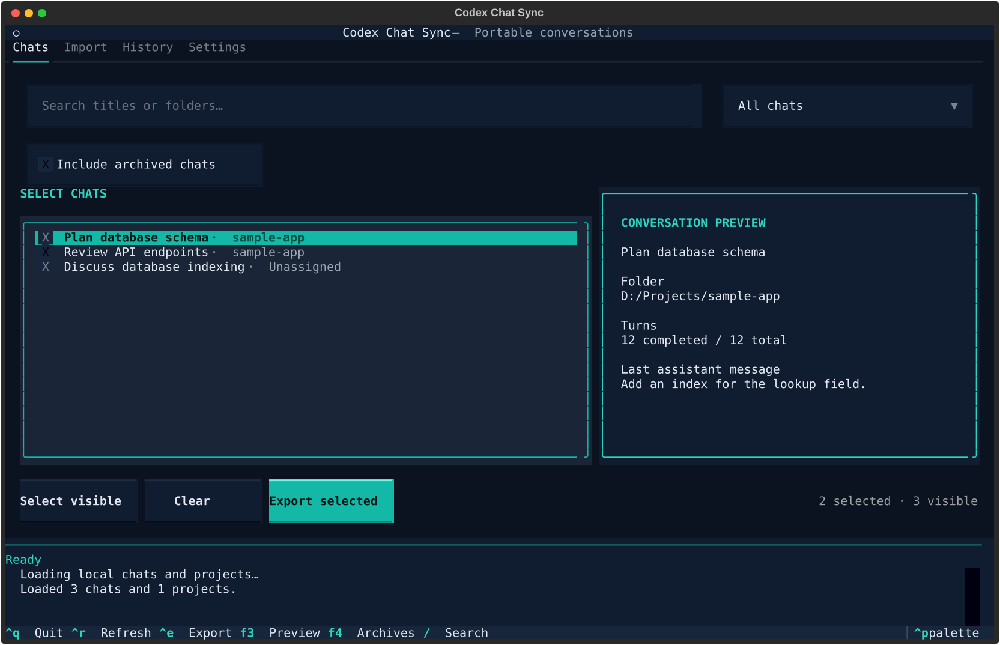
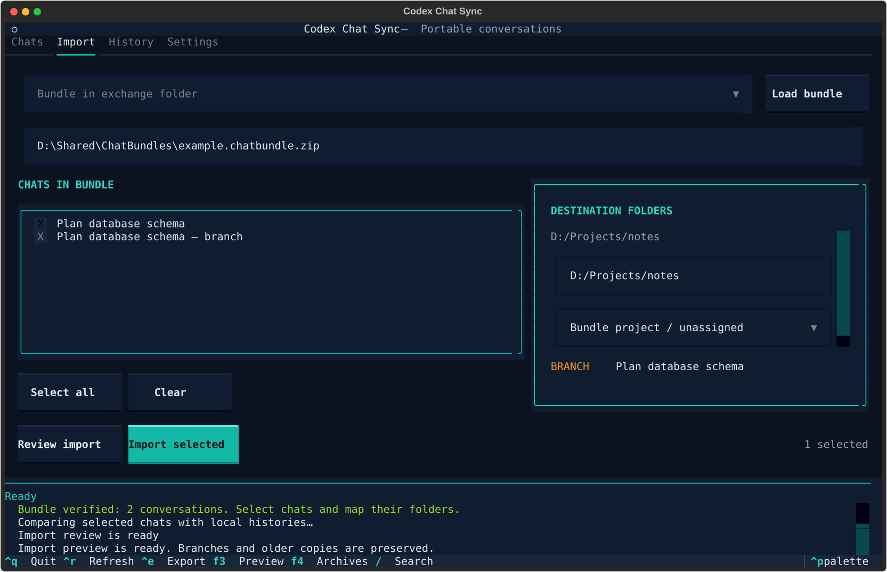

# Codex Chat Sync

A terminal tool for moving selected Codex chats between devices. The optional Textual interface adds keyboard navigation, multiple selection, previews and saved settings. Core commands require only Python 3.11+ and a compatible Codex CLI. No web server, hosted service or SSH is required.

## Start

Install the optional interface in a project-local environment. On Windows:

```powershell
python -m venv .venv
.\.venv\Scripts\python.exe -m pip install -r requirements-tui.txt
.\run.cmd
```

`run.cmd` prefers `CHATSYNC_PYTHON` when set, then the project’s `.venv`, then a standard per-user Python installation or the `py -3` launcher. No virtual-environment activation or global package installation is needed. If `python` opens the Microsoft Store, use an installed Python interpreter or the `py -3` launcher to create the environment.

On macOS/Linux, the interface can be launched with:

```sh
python3 -m venv .venv
.venv/bin/python -m pip install -r requirements-tui.txt
.venv/bin/python chat_sync.py tui
```

Textual supports these platforms; the complete migration workflow has device-level acceptance coverage on Windows only.

The first interface launch opens Settings when no configuration exists. Enter the device paths and choose **Save device settings**. Existing configuration is reused automatically. On Windows, select the actual `codex.exe`, rather than the npm `.cmd`/PowerShell wrapper.

Without the optional dependency, use the original text menu and setup commands:

```text
python chat_sync.py setup
python chat_sync.py menu
```

Launching without a command opens the Textual interface when installed and otherwise falls back to the text menu. Explicit `tui` mode explains how to install the dependency if it is missing. All single-line export/import commands remain available.

Setup asks for your Codex data folder, Codex executable, bundle exchange folder and a **local state folder outside your synced folders**. Paths are entered/confirmed by you and saved per device. Settings are independent of the account name, project location and device pair. Settings → Edit device paths changes them later. Each device uses its own settings and receipts, even when this program's source folder is synced.

Default settings: `%LOCALAPPDATA%\CodexChatSync\config.json` on Windows; `~/.local/share/CodexChatSync/config.json` elsewhere. Override with `--config PATH` before the command, or `CHATSYNC_CONFIG`.

## Terminal interface



- **Chats:** search titles/folders, filter by project or folder, select multiple chats with Space, and view the latest message and completed-turn count. Selection survives filtering. Select visible chats in several project filters to export multiple projects together.
- **Import:** load a bundle, select exact conversation versions, map only their required destination folders, and review New/Update/Branch/Duplicate/Older/Relocate results before confirmation. Changing selection or mappings invalidates the preview. A changed bundle must be loaded again.
- **History:** review committed or interrupted operation journals and confirm rollback of imported copies.
- **Settings:** edit saved device paths, device label and folder/project mappings.

Keyboard: arrows navigate chat lists, Space toggles selections, Tab moves between controls, `/` focuses search, Ctrl+E exports selected chats, Ctrl+R refreshes, F3 opens the conversation preview, F4 includes/hides archived chats, Ctrl+Q quits, and Escape closes dialogs. Mouse input is supported. Busy operations run in background workers; overlapping operations and quitting during a transaction are prevented.

Small terminals use a compact layout with an F3 preview dialog. Import completion shows resume commands in a dialog as well as the activity panel. Progress shows actual phases rather than an estimated percentage. The interface respects `NO_COLOR`; a modern color-capable terminal displays the dark teal theme.



## Configuration examples

The following locations illustrate a Windows configuration. Environment variables resolve to the current account; project and exchange folders can be placed elsewhere.

| Setting | Example location |
|---|---|
| Codex data | `%USERPROFILE%\.codex` |
| Local state | `%LOCALAPPDATA%\CodexChatSync\state` |
| Bundle exchange | `D:\Shared\ChatBundles` |
| Project folder | `D:\Projects\sample-app` |

In PowerShell, expand environment variables with `$env:` when passing arguments:

```powershell
.\run.cmd setup --codex-home "$env:USERPROFILE\.codex" --exchange-dir "D:\Shared\ChatBundles" --state-dir "$env:LOCALAPPDATA\CodexChatSync\state"
```

Setup prompts for the Codex executable if it is not supplied. When entering a path in an interactive prompt, use the resolved absolute path; the `%VARIABLE%` notation in the table is documentation notation.

## Export and import

The export menu supports chats across projects, all chats in multiple selected projects, or chats selected by folder. Enter `1,3-5` or `all` to select multiple entries. Unassigned ordinary chats are included in the chat picker. Project membership and folder grouping are separate options because older Codex versions sometimes leave project membership empty.

Each export produces one immutable `.chatbundle.zip`. Put the exchange folder wherever your existing file-transfer/sync service runs. The tool handles export and import; your transport copies the bundle between devices. It never automatically imports every file that arrives.

On import, choose the bundled chats and map their source folders to existing folders on this device. You can choose existing Codex projects; project chats can also recreate a native project. Folder/project mappings are saved and can be edited in Settings. Multiple selected chats may use different destination mappings.

The tool validates the bundle and reconstructs all selected history in a temporary, unauthenticated Codex data folder before adding copies to your actual Codex data folder. It checks completed turns again after restarting. Existing raw conversations and databases are never replaced or directly edited.

Import results:

- `same`: the completed history is already available; no duplicate is created.
- `stale`: a local conversation already includes the incoming history; nothing is replaced.
- `update`: the incoming history extends a local version; a new resumable snapshot is created and the earlier copy remains available.
- `branch`: the histories have different messages/content; both survive. The new title names its source device.
- `new`: this logical chat has not been imported here before.
- `relocate`: the same completed history exists in a different folder/project; a new copy uses the changed mapping.

Continue using the returned resume ID: `codex resume ID`. Close the same chat in other local clients if Codex reports an exclusive writer lock. The desktop may need to be reopened to refresh newly registered chats. Native project assignment is verified through the protocol; older desktop builds also maintain a separate sidebar project cache, so their sidebar may require opening the chat and assigning its project in the app. This tool does not edit that private cache.

## Commands

```text
python chat_sync.py tui
python chat_sync.py menu
python chat_sync.py list
python chat_sync.py list --archived
python chat_sync.py export --thread ID1 --thread ID2
python chat_sync.py export --project PROJECT1 --project PROJECT2
python chat_sync.py export --cwd "absolute/project/folder"
python chat_sync.py export --thread ID --asset "absolute/file/path"
python chat_sync.py inspect "bundle.chatbundle.zip"
python chat_sync.py import "bundle.chatbundle.zip" --dry-run --map "SOURCE=DESTINATION"
python chat_sync.py import "bundle.chatbundle.zip" --yes --map "SOURCE=DESTINATION"
python chat_sync.py import "bundle.chatbundle.zip" --chat LOGICAL_ID1 --chat LOGICAL_ID2
python chat_sync.py doctor
python chat_sync.py rollback OPERATION_ID
```

`--map` and `--project-map SOURCE=LOCAL_PROJECT_ID` can each be repeated. `--chat` uses the logical IDs printed by `inspect`, while `export --thread` uses physical Codex IDs printed by `list`. Interactive import previews its actions before confirmation. `--yes` requires saved or explicit mappings.

Rollback archives only the imported copies for that operation. Their messages remain recoverable through Codex's archive; originals remain available. Operation journals and pre-import receipt backups live in the configured local state folder. Interrupted imports retain their new files/evidence and a prepared/failed journal; they do not delete original chats. Keep local receipts backed up: they link logical chats to device-local IDs across repeated exports.

## Attachments and limits

Structured local image, audio and file-mention inputs are included automatically. Inline image data remains in the transcript. Other files mentioned in prose, files read by tools, generated files, code repositories and environments are **not inferred or copied**: include needed documents explicitly with `--asset`, and transfer project files separately. Attachments are stored under the configured local state folder by content hash; user project files are never overwritten. Historical text and historical tool folders retain their original values. Changing the local state folder copies managed receipts/assets and retains the old folder as a backup; keep that backup because previously imported image paths may still reference it.

Bundles contain private conversation text/tool outputs and may contain sensitive information that was already in the chat. They do not include account credentials, configuration files or whole Codex databases. Keep bundles and receipts private. Import rejects unsafe ZIP paths, duplicate members, symlinks, unsupported formats, invalid dependencies and failed checksums. Limits: 256 MiB per file, 1 GiB total uncompressed, 10,000 archive members. Authentication, plugins and tools must already be configured on the destination when you continue a conversation.

## Compatibility and verification

Codex path-resume and paginated-history APIs are experimental. The tool enables the required capability and fails when a build cannot reconstruct the exact exported history. It cannot promise compatibility with every future Codex storage version. Export currently requires all persisted turns to be completed; finish interrupted/active turns in Codex first.

Core and optional interface tests (Textual interaction tests are skipped if the dependency is not installed):

```text
python -m unittest discover -s tests -v
```

Real integration tests require `CHATSYNC_TEST_CODEX` (the actual executable) and `CHATSYNC_TEST_FIXTURE` (a local parent/fork regression fixture ZIP containing a nine-turn parent and its ten-turn descendant). They use isolated data folders, no accounts and no model calls. See `VALIDATION.md` for recorded results and remaining acceptance limits.

Protocol reference: [official Codex app-server documentation](https://learn.chatgpt.com/docs/app-server).

## Source layout and branches

`main` contains the standard-library CLI and shared application code. Interface
branches merge core updates from `main`; UI dependencies stay on those branches.
The `terminal-ui` branch contains the optional Textual interface.

```text
chatsync/
  core/                   Configuration, executable discovery, RPC, bundles,
                          migration engine and ChatSyncService
  interfaces/
    cli/app.py            Command parsing, prompts and plain terminal output
    terminal/app.py       Textual screens and presentation
    terminal/launcher.py  Optional UI dispatch with CLI fallback
tests/
  core/                   Engine, service, bundle and dependency-boundary tests
  cli/                    Command routing and selection tests
  terminal/               Headless Textual interaction and launch routing tests
chat_sync.py              Stable command entry point; UI dispatch on this branch
run.cmd                   Windows launcher
```

Interfaces depend on `chatsync.core`; core never imports an interface framework.
`ChatSyncService` provides settings, inventory, previews, bundle review, migration
and operation history for future interfaces. Engine progress callbacks are optional;
failing display callbacks cannot interrupt a migration. `import_bundle` also accepts
`selected_nodes` to choose exact bundled branch snapshots, while the existing CLI
`--chat` option continues to select logical chat families.

Python module imports now use `chatsync.core.*` and
`chatsync.interfaces.cli.app`. Existing shell commands, device settings, bundle
format and receipt locations remain unchanged.

Run the default checks with `python -m unittest discover -s tests -v`.
Native integration checks additionally require `CHATSYNC_TEST_CODEX` and
`CHATSYNC_TEST_FIXTURE`, as described in the integration test module.

The terminal interface uses `chatsync.core.service.ChatSyncService` directly.
There is no separate UI migration engine or service implementation. The core
modules and plain CLI implementation are inherited unchanged from `main`.
